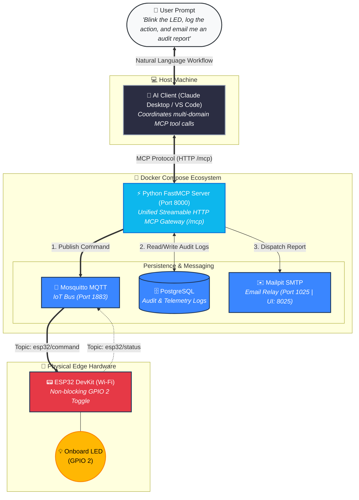

# 🚀 Omni-Channel MCP Gateway: ESP32 IoT, Database & Email Orchestration

A containerized **Model Context Protocol (MCP)** demonstration project showcasing how AI agents can orchestrate cross-domain workflows—controlling physical **ESP32 hardware**, logging audit trails in **PostgreSQL**, and dispatching automated **SMTP email reports**—all from a single natural language prompt.

---

## 🏗️ System Architecture



---

## ✨ Exposed MCP Capabilities

| Domain | Type | Name | Description |
| :--- | :--- | :--- | :--- |
| **IoT (ESP32)** | Tool | `set_led_state(state)` | Controls the ESP32 onboard LED (`ON`, `OFF`, or `BLINK`) via MQTT. |
| **IoT (ESP32)** | Resource | `esp32://device/state` | Returns live connectivity status and current GPIO state. |
| **Database** | Tool | `get_command_history(limit)` | Queries PostgreSQL for recent hardware execution logs. |
| **Email (SMTP)** | Tool | `send_device_report(email)` | Compiles live telemetry + DB history into an email via SMTP. |

---

## 🛠️ Quick Start Guide

### 1. Start the Docker Infrastructure
Clone the repository and spin up the FastMCP server, Mosquitto MQTT broker, PostgreSQL database, and Mailpit SMTP server:

```bash
git clone https://github.com/yourusername/esp32-mcp-iot-controller.git
cd esp32-mcp-iot-controller
docker compose up --build -d
```

Verify that all services are running:
* **MCP Endpoint:** `http://localhost:8000/mcp`
* **Mailpit Web Inbox (Inspect sent emails):** `http://localhost:8025`
* **MQTT Broker:** `localhost:1883`

### 2. Flash the ESP32 Firmware
1. Open `firmware/esp32_mcp_client.ino` in the Arduino IDE or PlatformIO.
2. Update your Wi-Fi credentials and set `mqtt_server` to your host machine's local IPv4 address (e.g., `192.168.1.50`).
3. Flash the firmware to your ESP32 DevKit and verify the connection in the Serial Monitor (`115200 baud`).

---

## 🔌 Connecting Your AI Client

### Option A: Claude Desktop (`claude_desktop_config.json`)

Claude Desktop uses `mcp-remote` to bridge local stdio transport to your containerized HTTP MCP server.

1. Open your Claude Desktop configuration file:
   * **macOS:** `~/Library/Application Support/Claude/claude_desktop_config.json`
   * **Windows:** `%APPDATA%\Claude\claude_desktop_config.json`
2. Add the following configuration (replace `<host>` and `<port>` with `localhost` and `8000` if running locally):

```json
{
  "mcpServers": {
    "esp32-omni-gateway": {
      "command": "npx",
      "args": [
        "-y",
        "mcp-remote",
        "http://localhost:8000/mcp"
      ]
    }
  }
}
```
3. Completely restart **Claude Desktop**. Look for the hammer/tools icon (`🔨`) to confirm your MCP tools are active.

---

### Option B: VS Code (`mcp.json` / `mcp-config.json`)

VS Code supports direct HTTP connections to MCP servers without requiring an `npx` proxy wrapper.

1. Open your workspace or user MCP configuration file (`.vscode/mcp.json` or your global `mcp-config.json`).
2. Add the server definition:

```json
{
  "mcpServers": {
    "esp32-omni-gateway": {
      "tools": [
        "*"
      ],
      "type": "http",
      "url": "http://localhost:8000/mcp"
    }
  }
}
```
3. Reload the VS Code window (`Ctrl+Shift+P` -> `Developer: Reload Window`) and open Copilot Chat in **Agent Mode** to start invoking tools.

---

## 🧪 Example Prompts to Try

Once connected, test multi-domain orchestration with a single prompt:

* **Hardware Control:**
  > *"Check if the ESP32 is online, then set the onboard LED to BLINK mode."*
* **Database Audit:**
  > *"Show me the last 5 commands executed on the ESP32 from the PostgreSQL database."*
* **Full Cross-Domain Workflow (IoT + DB + Email):**
  > *"Turn ON the ESP32 LED, verify its updated state, query the recent command history, and email a full system status report to admin@example.com."*
  *(Open `http://localhost:8025` in your browser to view the email captured by Mailpit!)*
